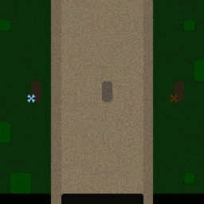

# Allan over vejen

Allan og hans venner har lavet en leg på motorvejen.



A remake of the Warcraft 3 map *Allan over vejen*, written in [Saad](https://github.com/jakobsaadbye/Saad) with raylib.
Get your hero across a busy motorway without being run over. Every time a car gets you, you go on with a new hero at
random. Every crossing makes the traffic faster, and the next hero starts on the side you got to, and crosses back.

The traffic all drives one way, from the top of the screen to the bottom. Every car has a speed of its own and drives
straight through slower cars in its lane, and the cars are nearly as wide as their lanes, so there is nowhere to hide
between them.

## Running it

With `saad` on the PATH (see the readme of Saad):

```
cd src
saad run main.sd
```

It can be started from any folder: it finds `data/` next to `src/` from where the program is (`src/build/out.exe`).

## The data folder

| | |
| --- | --- |
| `data/textures/` | The grass (`grass/grass.png`), the road (`road/asphalt.png`), the Warcraft cursor |
| `data/models/` | The vehicles (car, van, truck), the heroes and a segment of the wall, as OBJ with a MTL of their colors |
| `data/icons/` | A 64x64 icon for each ability, by the name in `heroes.sd` |
| `data/sounds/` | The sound effects, by group: `hero/`, `car/`, `ability/`, `ui/` |
| `data/music/` | The music (`theme.ogg`) and the hum of the traffic (`traffic.ogg`), looped |
| `data/fonts/` | Cinzel (titles) and Fira Sans (text), both under the SIL Open Font License |
| `data/shaders/` | `lighting.vs` and `lighting.fs`: the sun, ambient light and the haze in the distance |
| `data/window_icon.png` | |

The models were made by `tools/make_models.py`, the grass, the asphalt and the icons by `tools/make_textures.py`, and
the sounds and the music by `tools/make_sounds.py`
(run them with python3 to write the files again), but they are plain files that can just as well be edited in Blender or
painted over. `Grass_02.png` and `Ground_03.png` aren't used any more. The game expects a model to look towards +z and stand on y = 0, in the units
of the game. The body of a vehicle, the part that gets the color of the car, is the material that is pure white
(`Kd 1 1 1`), and the sizes of the vehicles are those of `config.sd` (`CarWidth`, `CarLength`, ...).

## Sounds

A sound is played by its name, e.g `sound.play("car.horn")`, or `sound.playAt("hero.step", position)` for one that is
quieter the further it is from the camera (`src/aov/sound.sd`). The name is the folder and the file in `data/sounds`:
`car.horn` is `data/sounds/car/horn.wav`. Files that end in a number are variants that are picked at random, e.g
`hero/step_1.wav` to `step_4.wav` are all `hero.step`. So a new sound is a file dropped into a folder there (`.wav`, `.ogg`
or `.mp3`), and a line that plays it. An ability plays the sound in its `sound` in `heroes.sd`.

| Sound | When |
| --- | --- |
| `hero.step` | Each step |
| `hero.hurt`, `hero.death` | A car on the hero, and run over |
| `hero.spawn`, `hero.crossed` | A new hero, and across the road |
| `car.horn` | A car coming up behind the hero honks, once |
| `ability.*` | The abilities: `sprint`, `charge`, `blink`, `hook_throw`, `hook_hit`, `freeze`, `fade` |
| `ui.click`, `ui.not_ready` | An order to walk, and an ability that is cooling down |

## Fonts

The titles are in **Cinzel**, after the Roman capitals that the titles of Dota 2 are in, and the rest in **Fira Sans**,
which is clear at small sizes. Dota 2's own font (Radiance) isn't free to use. Other free fonts that fit, from Google Fonts:

* Titles: **Cinzel** (used), **Cormorant SC**, **Marcellus SC** or **Forum**
* Text: **Fira Sans** (used), **Source Sans 3**, **Noto Sans** or **Inter**

A font is a `.ttf` in `data/fonts`, loaded in `loadFonts()` in `hud.sd`.

## Controls

| | |
| --- | --- |
| Right click (or left) | Walk there |
| Q, W, E, R, D, F | The abilities of the hero: the first is on Q, the second on W, ... Passives have no key |
| S | Stop |
| Y | Lock or unlock the camera. Locked (at the start), it follows the hero |
| Space (hold) | The camera to the hero |
| Arrow keys, or the mouse at the edge of the window | Move the camera, when it is unlocked |
| Mouse wheel | Zoom |
| M | Music on or off |
| P or Esc | Pause |
| F5 | New game |
| H | Hide the help |
| F1 / F2 / F3 | Wireframes / hitboxes / debug numbers |

The mouse on the icon of an ability shows what it does, and how far it reaches.

## Heroes

| Hero | Abilities |
| --- | --- |
| Allan | **Sprint** (Q): runs twice as fast for a moment. **Blink** (W): jumps to the cursor. **Quick feet** (passive): 10% faster |
| Ghosty | **Fade** (Q): the cars drive through him for 1.5 seconds. **Phase walk** (passive): floats through the walls |
| Butcher | **Meat hook** (Q): hooks the ground at the cursor and pulls himself there. **Charge** (W): very fast for a short moment |
| Frosty | **Cold snap** (Q): freezes the cars around him. **Slide** (W): slides to the cursor. **Chill aura** (passive): cars near him drive 40% slower |

Every hero has health. A car on a hero takes 100 a second (vans and trucks more), and a hero heals after 1.5 seconds without
one. Allan (25) and Ghosty (15) don't last long, but the Butcher (100) survives a car driving over him.

A hero can have any number of abilities, as many cast ones as there are keys, and passives. They are defined in `defineHeroes()` in `heroes.sd`: a
name, a description, an icon, a cooldown and an effect. A new kind of effect is a variant of `AbilityEffect`, and what it
does is in `useAbility()` in `game.sd` (or, for a passive, where it has its effect).

## The code

All of the game is in the namespace `aov`, in `src/aov/`. `src/main.sd` opens the window and runs the loop.

| File | |
| --- | --- |
| `config.sd` | The numbers that tune the game: the size of the field, the road, the traffic |
| `heroes.sd` | The heroes, their stats and their abilities |
| `world.sd` | The walls with their openings, and the collisions of the heroes with them |
| `traffic.sd` | The lanes and the cars |
| `game.sd` | The game itself: input, the hero, being run over, crossing, the next hero |
| `camera.sd` | The RTS camera |
| `effects.sd` | The click marker, the stains, the bits flying and the rings of the abilities |
| `assets.sd`, `lighting.sd` | The textures, models and shader of the data folder |
| `render.sd`, `hud.sd` | The 3D scene and the 2D overlay |

`src/simulation_test.sd` plays the game without a window and checks the rules: the walls, the traffic (one way, cars
passing through each other, no room between the lanes), being run over, crossing and crossing back, and the abilities.

```
cd src
saad run simulation_test.sd
```
